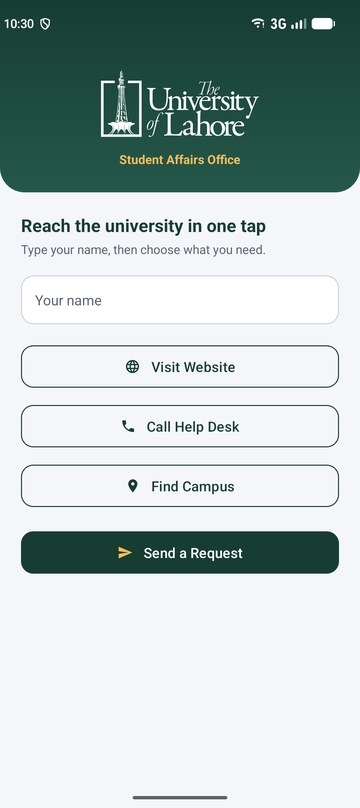
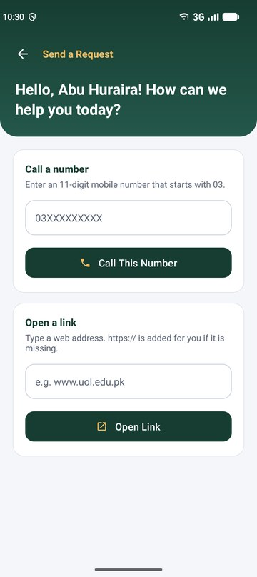
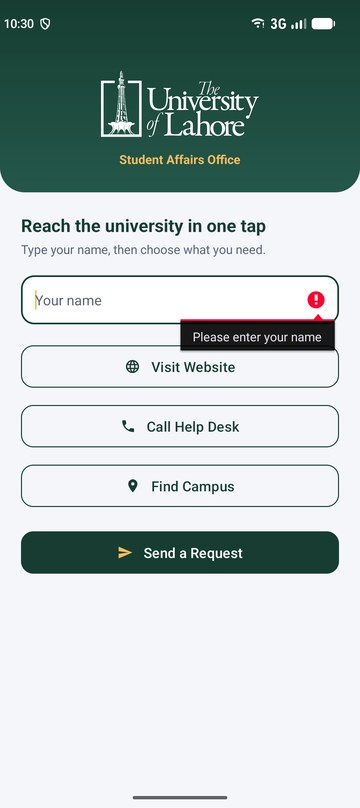
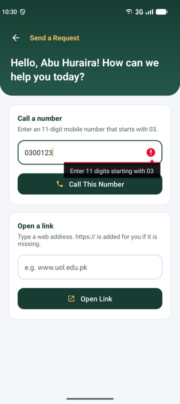
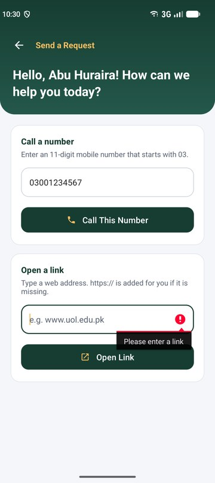

# UOL Help Desk

A small Android app in Java that lets a University of Lahore student reach the university in one tap. I built it for the Mobile Application Development (CS02310) lab task on implicit intents, BS Software Engineering, Fall 2026, Section S.

The home screen opens the university website, the phone dialer and the campus location in maps through implicit intents. A second screen, reached with an explicit intent, greets the student by name and lets them dial a mobile number or open a web link after checking the input.

<p>
  
  
  
</p>

## Features

Home screen (`MainActivity`)

- University logo, a name field and four buttons: Visit Website, Call Help Desk, Find Campus and Send a Request.
- Visit Website opens https://www.uol.edu.pk in the browser with `Intent.ACTION_VIEW`.
- Call Help Desk opens the dialer with 04212345678 already typed, using `Intent.ACTION_DIAL`. No call is placed.
- Find Campus shows the University of Lahore in the maps app with the Uri `geo:0,0?q=University+of+Lahore`.
- Send a Request rejects an empty name with `setError()`, otherwise opens `RequestActivity` with an explicit intent and passes the name through `putExtra()`.

Request screen (`RequestActivity`)

- Shows "Hello, &lt;name&gt;! How can we help you today?", or uses "Student" if no name arrived.
- Phone field (`inputType="phone"`) and a Call This Number button. Only 11 digits starting with 03 are accepted.
- Link field (`inputType="textUri"`) and an Open Link button. An empty link is rejected, and `https://` is added when the link does not start with `http://` or `https://`.

Every intent that leaves the app goes through one helper:

```java
public static void openIntent(Context context, Intent intent) {
    try {
        context.startActivity(intent);
    } catch (ActivityNotFoundException e) {
        Toast.makeText(context, R.string.toast_no_app, Toast.LENGTH_SHORT).show();
    }
}
```

If no installed app can handle the intent, the user sees "No app found for this action" and the app keeps running.

## Intents used

| Button | Action | Data | Opens |
|---|---|---|---|
| Visit Website | `ACTION_VIEW` | `https://www.uol.edu.pk` | Browser |
| Call Help Desk | `ACTION_DIAL` | `tel:04212345678` | Dialer |
| Find Campus | `ACTION_VIEW` | `geo:0,0?q=University+of+Lahore` | Maps |
| Send a Request | explicit | `RequestActivity` + name extra | Second screen |
| Call This Number | `ACTION_DIAL` | `tel:` + typed number | Dialer |
| Open Link | `ACTION_VIEW` | typed link, `https://` added if missing | Browser |

## Input validation

<p>
  
  
  
</p>

The phone and link rules live in two small static methods in `RequestActivity` (`isValidMobileNumber` and `toWebLink`), so they can be tested without a device. The tests are in `app/src/test/.../RequestValidationTest.java`.

## Project structure

```
app/src/main/
├── AndroidManifest.xml              MainActivity (launcher) and RequestActivity
├── java/com/example/uolhelpdesk/
│   ├── MainActivity.java            home screen, implicit intents, openIntent()
│   └── RequestActivity.java         greeting, phone and link validation
└── res/
    ├── layout/activity_main.xml
    ├── layout/activity_request.xml
    ├── drawable/                    icons, header and input backgrounds
    ├── drawable-nodpi/uol_logo.png
    └── values/                      strings, colours, theme and styles
```

## Build and run

Requirements: Android Studio (Panda 2025.3 or newer), JDK 21 (bundled with Android Studio) and an emulator or phone with Android 7.0 (API 24) or higher.

1. Clone the repository and open the folder in Android Studio.
2. Wait for the Gradle sync to finish.
3. Select an emulator and press Run.

From the command line:

```
gradlew assembleDebug        # build the debug APK
gradlew testDebugUnitTest    # run the unit tests
```

The emulator image should include Google Play (or at least Chrome, Phone and Maps) so the three implicit intents have an app to open.

## Author

Abu Huraira, SAP ID 70145777, BS Software Engineering (7th semester), The University of Lahore.
